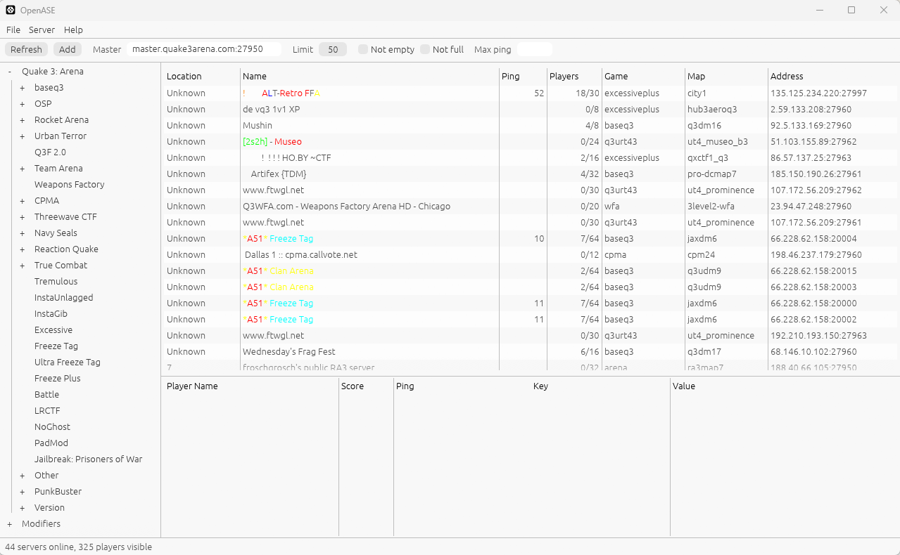

# OpenASE

Website: https://tsautier.github.io/OpenASE/

OpenASE is an open-source game server browser in the spirit of The All-Seeing
Eye: a filter tree on the left, the server list with Ping, Flux and PL on the
right, and friends, players and server rules at the bottom.

It is new code. It does not use, modify or ship anything from the original
Yahoo program.



## Supported games

| Game | Protocol | Server list from |
|---|---|---|
| Quake 3: Arena | Quake 3 | master.quake3arena.com, master0.excessiveplus.net, dpmaster.deathmask.net |
| Urban Terror | Quake 3 | master.urbanterror.info, master2.urbanterror.info |
| OpenArena | Quake 3 | dpmaster.deathmask.net |
| Wolfenstein: Enemy Territory | Quake 3 | etmaster.idsoftware.com, etmaster.etlegacy.com |
| Call of Duty, CoD 2, CoD 4 | Quake 3 | Activision masters |
| Unreal Tournament (99) | GameSpy | master.333networks.com |
| Counter-Strike 1.6 | Valve A2S | Steam Web API (needs your own key) |

Games are described in [`rust/src/games.json`](rust/src/games.json): masters,
game types, filter groups, registry detection and the command line used to join.

## Features

- **Ping, Flux and PL** measured like ASE: several queries per server, average
  round-trip time, half the spread between fastest and slowest, and packet loss.
- **Filter tree**: game types as folders, checkbox groups per game (Mods,
  Friendly Fire, Kill Cam, Pure, PunkBuster, Version, Maps) and **Modifiers**
  (not empty, not full, no password, unresponsive, ping, **country**).
- **Location** column and country filter from the free DB-IP country database,
  downloaded once a month (can be turned off in Options > General).
- **My filters**: build rules such as `players greater than 4` or
  `map contains toujane`; tick *color filter* to highlight matching servers.
- **Favorites1 to 8**, **Special** lists (recently added, imported, joined)
  and **LAN servers** found by broadcast.
- **Join** with a double-click or Enter, with the right mod, player name, config
  and password. Steam games fall back to `steam://connect`.
- **Friends** in groups Friends1 to 4, optionally per game, with a Friends pane,
  notices and sound. **Friend name search** across every scanned server.
- **File menu**: export / import your whole profile, save / import server lists,
  update check against GitHub Releases, setup wizard.
- **Options**: General (Steam key, GeoIP), Network (timeouts, pings, retries,
  parallel queries), Events, Games (installed / not installed, **Auto-Search**).
- Shortcuts: F5 refresh, Enter join, Ctrl+E show selected, Ctrl+D clear
  modifiers, Ctrl+Q collapse all, F1 manual.

## Download

Every [GitHub release](https://github.com/tsautier/OpenASE/releases/latest) ships three packages:

| System | Package | How to run |
| --- | --- | --- |
| Windows 10/11 (x64) | `OpenASE-<version>-windows-x64.zip` | Unzip, run `OpenASE.exe`. |
| Linux (x64) | `OpenASE-<version>-linux-x64.tar.gz` | Extract, run `./openase`. An `openase.desktop` file and icon are included. |
| macOS 11+ (Apple Silicon and Intel) | `OpenASE-<version>-macos-universal.zip` | Unzip, move `OpenASE.app` to Applications. The app is not notarized: the first time, right-click it and choose **Open**, or run `xattr -dr com.apple.quarantine /Applications/OpenASE.app`. |

The games themselves still need to run on your system: native Linux and macOS
builds exist for ioquake3, Urban Terror, OpenArena, ET: Legacy, Unreal
Tournament (OldUnreal patch) and Counter-Strike 1.6 (Steam). Call of Duty runs
on Windows only, or through Wine / Proton.

## Build from source (Rust)

Requires Rust 1.88 or newer. On Linux, install the GUI libraries first
(Debian / Ubuntu: `sudo apt install libxcb-render0-dev libxcb-shape0-dev
libxcb-xfixes0-dev libxkbcommon-dev libgtk-3-dev`).

```powershell
cd rust
cargo run --release
```

Command-line tools, useful to test a master or a server:

```powershell
cargo run --example scan -- list              # list game ids
cargo run --example scan -- cod2 20           # scan 20 CoD2 servers
cargo run --example query -- ut99 1.2.3.4:7778
cargo test
```

Settings are stored in `%APPDATA%\OpenASE\settings.json` on Windows
(`~/.config/OpenASE` on Linux, `~/Library/Application Support/OpenASE` on macOS).

### Counter-Strike 1.6

Valve's old UDP master no longer answers, so the list comes from the Steam Web
API. Get a free key at https://steamcommunity.com/dev/apikey and paste it in
Options > General. Servers added by hand work without a key.

## References

- Quake 3 connectionless queries: Jacek Fedorynski, "Quake 3 Network Protocol"
  (2020), https://www.jfedor.org/quake3/
- Valve server queries (A2S): Valve Developer Wiki, "Server queries".
- GameSpy master protocol: 333networks, https://333networks.com/
- Yahoo acquired The All-Seeing Eye in September 2004:
  https://www.gamedeveloper.com/game-platforms/yahoo-games-adds-all-seeing-eye-gamespot-syndication

## License

Copyright (C) 2026 tsautier

OpenASE is free software: you can redistribute it and/or modify it under the
terms of the GNU General Public License as published by the Free Software
Foundation, either version 3 of the License, or (at your option) any later
version. See [LICENSE](LICENSE) for the full text.

OpenASE is not affiliated with Yahoo or the original All-Seeing Eye authors.
Game names are trademarks of their owners.

IP geolocation by [DB-IP](https://db-ip.com) (CC BY 4.0), downloaded at runtime. No original ASE files are distributed
with this project.
